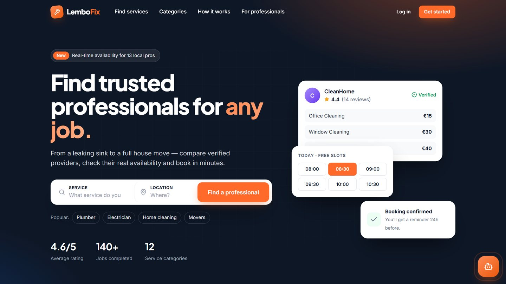
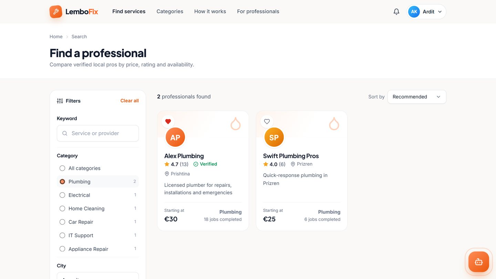
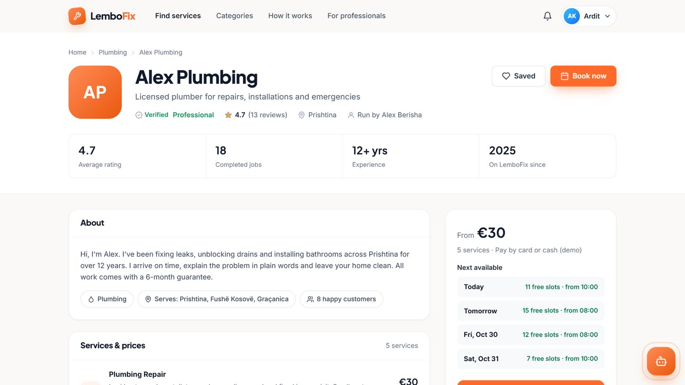
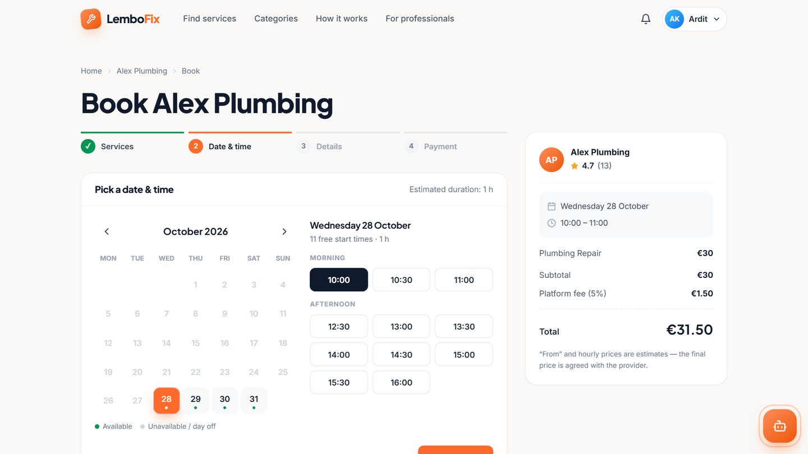
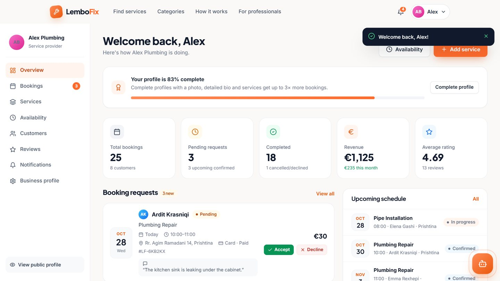
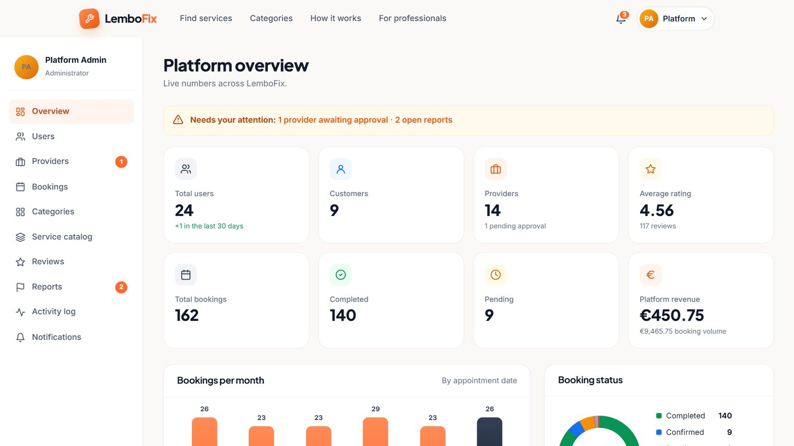

# LemboFix 🔧

**Find trusted professionals for any job.**

LemboFix is a full-stack service marketplace and booking platform. Customers discover local professionals (plumbers, electricians, cleaners, mechanics, photographers and more), compare ratings and prices, see **real-time availability**, and book online. Providers manage their services, calendar and bookings; administrators moderate the whole platform. An AI assistant, **LemboBot**, powered by Groq, helps users find the right service.

Built with plain **PHP 8 + MySQL/MariaDB + vanilla HTML/CSS/JS** — no frameworks — to show clean, secure, maintainable full-stack fundamentals.

---

## ✨ Features

### Customers
- Register / log in, profile with photo, address and preferences
- Search by service or provider name; filter by category, city, price and rating; sort by recommendation, rating, popularity or price (AJAX, shareable URLs)
- Detailed provider profiles: verification badge, rating breakdown, services and prices, working hours, next free days, reviews with provider replies
- **4-step booking wizard**: services → live calendar & time slots → address → demo payment
- Cancel bookings (business rules), booking history with tabs, receipts
- Favorites, in-app notifications with unread badge, 24-hour appointment reminders
- Reviews (1–5 ★) only after **completed** bookings, one per booking

### Providers
- Register as a professional (admin approval required before going public)
- Business profile, categories, service area, profile photo
- Services CRUD: title, description, price (fixed / from / hourly), duration, location
- Availability: weekly hours, breaks, days off and vacations, 14-day preview
- Booking requests: accept / decline (with reason) → start job → mark completed
- Dashboard: bookings, pending requests, revenue (6-month chart), top services, rating
- Customers list, reviews with public replies, report abusive reviews

### Administrators
- Dashboard: users, customers, providers, bookings, completed/pending, revenue, average rating + charts
- Users: search, filter, suspend / reactivate (suspended users are signed out immediately)
- Providers: approve / reject (with reason), verify, suspend
- Bookings: filter by status/date/search, change status
- Categories and service catalog CRUD
- Review moderation (hide / republish / delete) and reported-content queue
- Activity log (audit trail)

### LemboBot 🤖
- Floating chat widget on every page (full-screen on mobile)
- Understands problems like *"my sink is leaking"* → suggests **Plumbing → Leak Repair** and shows real provider cards from the database
- **AI mode** via Groq (OpenAI-compatible API) when a key is configured; **Basic mode** (rule-based + database search) otherwise or if the AI is unavailable
- Server-side only: `Browser → api/chatbot.php → Groq → api/chatbot.php → Browser`

---

## 🧱 Tech stack

| Layer | Technology |
|---|---|
| Frontend | HTML5, CSS3 (custom design system with CSS variables), vanilla JavaScript, Fetch API |
| Backend | PHP 8.1+ (tested on 8.5), PDO, sessions, REST-style JSON endpoints |
| Database | MySQL 8 / MariaDB 10.4+ (InnoDB, utf8mb4) |
| AI | Groq Chat Completions (`openai/gpt-oss-120b` by default, configurable) |
| Server | Apache via XAMPP |

---

## 📁 Project structure

```
lembofix/
├── index.php, search.php, provider.php, book.php, booking-success.php
├── categories.php, for-professionals.php, notifications.php
├── login.php, register.php, logout.php, forgot-password.php, reset-password.php
├── customer/   dashboard, bookings, favorites, reviews, profile
├── provider/   dashboard, bookings, services, availability, customers, reviews, profile
├── admin/      dashboard, users, providers, bookings, categories, services, reviews, reports, activity
├── api/        auth, search, availability, bookings, services, favorites, notifications, reviews, chatbot
├── config/     config.php (defaults + loader), database.php (PDO), local.example.php
├── includes/   bootstrap, auth, csrf, validation, availability engine, bookings, chatbot, layout, partials/
├── assets/     css/ (app.css, lembobot.css), js/ (app, search, booking, lembobot), images/, uploads/
└── database/   schema.sql (schema + demo data)
```

Pages handle their own form posts (Post/Redirect/Get). Business logic lives in `includes/` and is shared by pages and API endpoints. Every API endpoint returns JSON for `fetch()` calls and falls back to flash-message + redirect for normal form posts, so core actions also work without JavaScript.

---

## 🚀 Installation (XAMPP)

1. **Install XAMPP** (PHP 8.1+) and start **Apache** and **MySQL** in the XAMPP Control Panel.
2. **Get the code** into `htdocs` as a folder named `lembofix`:
   ```bash
   cd C:\xampp\htdocs
   git clone https://github.com/LedionImeri/LemboFix-.git lembofix
   ```
   (or download the ZIP from GitHub and extract it to `C:\xampp\htdocs\lembofix`).
3. **Import the database**
   - Open <http://localhost/phpmyadmin> → **Import** → choose `database/schema.sql` → **Go**.
   - Or from a terminal: `mysql -u root < database/schema.sql`
   - The script creates the `lembofix` database with all tables and realistic demo data. Demo dates are relative to the import day, so there are always upcoming bookings.
4. **Configure** (optional — defaults match a fresh XAMPP: `root` with an empty password)
   - Copy `config/local.example.php` → `config/local.php` **or** `.env.example` → `.env`, and edit the values.
5. Open **<http://localhost/lembofix/>** 🎉

> The base URL is detected automatically. If you use a virtual host or alias, set `app.url` (or `APP_URL`) — e.g. `''` for a site root or `/lembofix` for a subfolder.

### Required PHP extensions
`pdo_mysql`, `mbstring`, `fileinfo` (upload validation), `curl` (LemboBot AI mode) — all enabled in XAMPP by default (`fileinfo`/`curl` may need to be uncommented in `php.ini` on older installs).

---

## ⚙️ Configuration

Values are resolved in this order (later wins): defaults in `config/config.php` → `config/local.php` → `.env` → real environment variables.

| Setting | Env variable | Default |
|---|---|---|
| Base path | `APP_URL` | auto-detect |
| Environment | `APP_ENV` | `development` (shows errors; dev-only password-reset link) |
| Database | `DB_HOST`, `DB_PORT`, `DB_NAME`, `DB_USER`, `DB_PASS` | `127.0.0.1`, `3306`, `lembofix`, `root`, *(empty)* |
| Groq key | `GROQ_API_KEY` | *(empty → Basic mode)* |
| Groq model | `GROQ_MODEL` | `openai/gpt-oss-120b` |
| CA bundle | `GROQ_CA_BUNDLE` | *(empty)* |

Business rules (platform fee 5%, 30-min slot interval, 60-day booking window, 2-hour cancellation cutoff, chatbot rate limits…) live in `config_defaults()` and can be overridden in `config/local.php`.

---

## 🤖 Groq API setup (LemboBot AI mode)

1. Create a free API key at <https://console.groq.com/keys>.
2. Put it in **`config/local.php`** (`'groq' => ['api_key' => 'gsk_...']`) or in **`.env`** (`GROQ_API_KEY=gsk_...`). Both files are git-ignored.
3. Optionally change the model (`GROQ_MODEL`) to any current Groq chat model, e.g. `openai/gpt-oss-20b` for faster replies.
4. Reload the site — the LemboBot header shows **"AI assistant · online"**.

**SSL errors on Windows?** If cURL reports *"SSL certificate problem"*, download <https://curl.se/ca/cacert.pem> and set `GROQ_CA_BUNDLE` / `groq.ca_bundle` to its path.

Without a key (or if Groq fails/times out), LemboBot automatically answers in **Basic mode** using keyword intent detection and live database search, so the feature always works in demos.

**LemboBot safeguards:** API key only on the server; CSRF on every message; input validation (max 500 chars, control characters stripped); rate limits per user/IP (10-minute and daily windows, stricter for guests) and a minimum interval between messages; 20 s timeout; only public provider data is sent to the model; the system prompt forbids revealing instructions or private data; replies are rendered as escaped text with minimal formatting.

---

## 👤 Demo accounts

All demo accounts use the password **`Demo@1234`** (one-click buttons are also on the login page).

| Role | Email | What to try |
|---|---|---|
| Customer | `customer@lembofix.com` | Upcoming & pending bookings, a completed job waiting for a review, favorites |
| Provider | `provider@lembofix.com` | Alex Plumbing: 2 pending requests, a job in progress today, revenue chart |
| Admin | `admin@lembofix.com` | A provider awaiting approval, 2 open reports, a suspended user |

Other seeded providers include Pro Electric, TechCare IT, CleanHome, AutoFix Garage, GardenPro, QuickMove, ColorCraft Painting, FixIt Appliances, Glow Beauty Studio, Lens & Light Studio, Swift Plumbing Pros and HandyHub (`<name>@<business>.example.com`, same password).

---

## 🔐 Security notes

- **SQL injection:** every query uses PDO prepared statements (`ATTR_EMULATE_PREPARES = false`).
- **XSS:** all output goes through `e()` (`htmlspecialchars`); JS renders untrusted text with an escape helper; strict **Content-Security-Policy** (no inline scripts), `X-Frame-Options: DENY`, `nosniff`, `Referrer-Policy`.
- **CSRF:** per-session token on every state-changing request (form field or `X-CSRF-Token` header); logout is POST-only.
- **Authentication:** `password_hash()` / `password_verify()` with automatic rehash; session ID regenerated on login; HttpOnly + SameSite cookies; idle timeout; login throttling per email+IP; suspended users are signed out on their next request.
- **Authorization:** `require_login(role…)` on every page and endpoint, plus ownership checks (a provider can only change *their* bookings and services) and a per-role booking state machine.
- **Booking integrity:** slots are validated server-side; booking creation locks the provider row (`SELECT … FOR UPDATE`) inside a transaction, so two customers can't book the same time — even concurrently.
- **Uploads:** size limit, real MIME detection with `finfo` + `getimagesize`, JPG/PNG/WebP only, random file names, and an `.htaccess` in `assets/uploads/` that disables script execution.
- **Secrets:** `config/local.php` and `.env` are git-ignored; `config/`, `includes/` and `database/` are not web-accessible; dotfiles and `.sql`/`.md` files are blocked by `.htaccess`.
- **Privacy:** customer phone numbers are only shown to providers after they accept a booking; password-reset requests don't reveal whether an email exists.
- **Payments:** the checkout is a clearly labelled **demo** — no card data is collected or processed.

> Running in production? Set `APP_ENV=production` (hides error details), serve over HTTPS (session cookies become `Secure` automatically), and configure a mail service for password-reset emails.

---

## 🧪 What was tested

- Every page as guest / customer / provider / admin (expected 200 / 302 / 403 / 404, no PHP warnings or notices)
- Booking flow in the browser; double-booking of the same slot is rejected; CSRF-less requests are rejected with `403`
- Role & ownership checks (customer can't confirm, other providers can't touch a booking, customers can't use admin actions)
- Status transitions, cancellation rules, demo refunds, reviews (only after completion, no duplicates)
- XSS payloads are stored as text and rendered escaped
- LemboBot in Basic mode and against a mock Groq server (auth header, model, fallback when the key is invalid); the key never appears in any frontend response
- Mobile (375 px): no horizontal scroll; the hamburger menu is visible, clickable and works at the top, middle and bottom of long pages

---

## 📸 Screenshots

_Real screenshots of the running app with the seeded demo data._

| Home | Search | Provider profile |
|---|---|---|
|  |  |  |

| Booking wizard | Provider dashboard | Admin dashboard |
|---|---|---|
|  |  |  |

---

## 📄 License

MIT — free to use for learning and portfolio purposes.
